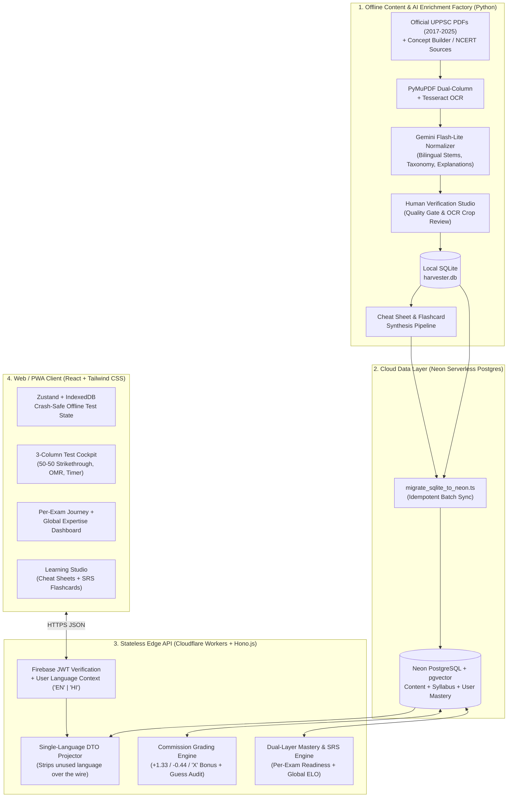

# System & Database Architecture Document
## Product: Sankalp — Adaptive Civil Services & UPPSC Learning Platform

**Document Version:** 1.0  
**Date:** November 7, 2026  
**Target Stack:** React / Next.js + Tailwind CSS • Cloudflare Workers (Hono.js) • Firebase Auth • Neon Serverless PostgreSQL (`pgvector`)  

---

## 1. High-Level System Topology

The architecture separates **offline heavy AI content enrichment** (Python Harvester & Synthesis Factory) from **ultra-low-latency, stateless student test delivery** on the Edge.



---

## 2. Core Architectural Decisions

| Concern | Decision | Rationale |
| :--- | :--- | :--- |
| **Single-Language Delivery** | Store bilingual columns (`_en`, `_hi`) in DB; project **only** `user.preferred_language` in Edge API DTOs | Zero schema duplication, instant language switching in profile, and ~45% smaller JSON payloads on mobile networks. |
| **Multi-Exam vs. Global Expertise** | Decouple `user_topic_mastery` (Global) from `user_exam_journeys` (Per-Exam) via `exam_syllabus_map` | Practicing a shared topic (e.g., *Panchayati Raj*) once updates global mastery and recalculates readiness across *all* UPPSC exams according to each exam's topic weights. |
| **Beyond-PYQ Extensibility** | Nullable `paper_id` + `question_origin`, `question_format`, `cognitive_skill`, and `topic_id` FK on `questions` | Allows seamless mixing of Official PYQs, AI/Expert Concept Builders, NCERT drills, and Current Affairs in any drill or mock test. |
| **Crash-Safe Exam Cockpit** | Local `IndexedDB` / `Zustand` persistence per click; single atomic `POST /submit` (+ periodic heartbeat) | Prevents 2-hour mock test progress loss during mobile network drops while keeping Edge Worker invocations minimal. |
| **Cloud Database** | **Neon Serverless PostgreSQL** with HTTP/WebSocket driver (`@neondatabase/serverless`) + `pgvector` | Native connection pooling for Cloudflare Workers, scale-to-zero cost efficiency, and native vector search for *"Practice 3 Similar Questions"*. |

---

## 3. Complete Production Database Schema (PostgreSQL DDL)

### 3.1 Canonical Exams & 3-Tier Syllabus Knowledge Graph

```sql
CREATE EXTENSION IF NOT EXISTS vector;

-- 1. Canonical Target Exams (e.g., UPPCS Prelims, RO/ARO, ACF/RFO, GIC, BEO)
CREATE TABLE exams (
    id TEXT PRIMARY KEY,                          -- 'uppcs_pcs', 'uppsc_ro_aro', 'uppsc_acf_rfo', 'uppsc_gic'
    code TEXT UNIQUE NOT NULL,                    -- 'PCS', 'RO_ARO', 'ACF_RFO', 'GIC'
    title_en TEXT NOT NULL,
    title_hi TEXT NOT NULL,
    conducting_body TEXT NOT NULL DEFAULT 'UPPSC',
    default_duration_mins INTEGER NOT NULL DEFAULT 120,
    default_positive_marks REAL NOT NULL DEFAULT 1.3333,
    default_negative_ratio REAL NOT NULL DEFAULT 0.3333, -- 1/3rd penalty
    is_active BOOLEAN NOT NULL DEFAULT TRUE,
    created_at TIMESTAMPTZ NOT NULL DEFAULT NOW()
);

-- 2. Normalized 3-Tier Syllabus Tree: Subject (L1) -> Theme (L2) -> Micro-Concept (L3)
CREATE TABLE syllabus_topics (
    id TEXT PRIMARY KEY,                          -- 'polity_local_govt_panchayati_raj'
    parent_id TEXT REFERENCES syllabus_topics(id) ON DELETE CASCADE,
    level SMALLINT NOT NULL CHECK (level IN (1, 2, 3)),
    slug TEXT UNIQUE NOT NULL,
    title_en TEXT NOT NULL,
    title_hi TEXT NOT NULL,
    breadcrumb_en TEXT NOT NULL,                  -- 'Indian Polity -> Local Government -> Panchayati Raj'
    breadcrumb_hi TEXT NOT NULL,                  -- 'भारतीय राजव्यवस्था -> स्थानीय स्वशासन -> पंचायती राज'
    sort_order INTEGER NOT NULL DEFAULT 0
);
CREATE INDEX idx_syllabus_parent ON syllabus_topics(parent_id);

-- 3. Exam <-> Syllabus Weightage Matrix (Bridges Global Mastery to Per-Exam Readiness)
CREATE TABLE exam_syllabus_map (
    exam_id TEXT NOT NULL REFERENCES exams(id) ON DELETE CASCADE,
    topic_id TEXT NOT NULL REFERENCES syllabus_topics(id) ON DELETE CASCADE,
    stage TEXT NOT NULL DEFAULT 'PRELIMS' CHECK (stage IN ('PRELIMS', 'MAINS')),
    expected_weight_pct REAL NOT NULL DEFAULT 1.0,-- Historical share of exam marks (sums to 100 per exam)
    priority_tier TEXT NOT NULL DEFAULT 'CORE' CHECK (priority_tier IN ('HIGH_YIELD', 'CORE', 'PERIPHERAL')),
    historical_pyq_count INTEGER NOT NULL DEFAULT 0,
    PRIMARY KEY (exam_id, topic_id, stage)
);
```

### 3.2 Question Bank, Provenance & Beyond-PYQ Content

```sql
-- 4. Official Question Booklets & Mock Test Papers
CREATE TABLE exam_papers (
    id TEXT PRIMARY KEY,
    target_exam_id TEXT REFERENCES exams(id),     -- Links paper to canonical exam journey
    exam_name TEXT NOT NULL,
    paper_name TEXT NOT NULL,
    stage TEXT CHECK (stage IN ('PRELIMS', 'MAINS', 'UNKNOWN')),
    paper_code TEXT,
    year INTEGER,
    series TEXT,
    is_official_pyq BOOLEAN NOT NULL DEFAULT TRUE,-- FALSE for platform-authored full-length mock papers
    has_official_key BOOLEAN NOT NULL DEFAULT FALSE,
    source_url TEXT,
    file_sha256 TEXT UNIQUE,
    page_count INTEGER,
    document_type TEXT NOT NULL DEFAULT 'QUESTION_PAPER'
        CHECK (document_type IN ('QUESTION_PAPER', 'ANSWER_KEY', 'OTHER')),
    scraped_at TIMESTAMPTZ NOT NULL DEFAULT NOW()
);

-- 5. Master Enriched Questions (PYQs + Concept Builders + NCERT + Current Affairs)
CREATE TABLE questions (
    id TEXT PRIMARY KEY,                          -- UUID v4
    paper_id TEXT REFERENCES exam_papers(id) ON DELETE SET NULL, -- NULL for standalone Concept Builders
    topic_id TEXT REFERENCES syllabus_topics(id) ON DELETE SET NULL,
    question_number INTEGER,
    subject TEXT,                                 -- Preserved macro-subject label
    topic TEXT,                                   -- Preserved raw breadcrumb ('Subject -> Theme -> Concept')
    question_origin TEXT NOT NULL DEFAULT 'PYQ'
        CHECK (question_origin IN ('PYQ', 'CONCEPT_BUILDER', 'NCERT_BASED', 'MOCK_TEST', 'CURRENT_AFFAIRS')),
    question_format TEXT NOT NULL DEFAULT 'SINGLE_CHOICE'
        CHECK (question_format IN ('SINGLE_CHOICE', 'MULTI_STATEMENT', 'ASSERTION_REASON', 'MATCH_THE_FOLLOWING', 'CHRONOLOGICAL')),
    cognitive_skill TEXT NOT NULL DEFAULT 'FACTUAL'
        CHECK (cognitive_skill IN ('FACTUAL', 'CONCEPTUAL', 'ANALYTICAL', 'APPLICATION')),
    difficulty TEXT NOT NULL DEFAULT 'MEDIUM'
        CHECK (difficulty IN ('EASY', 'MEDIUM', 'HARD')),
    language TEXT NOT NULL DEFAULT 'BILINGUAL'
        CHECK (language IN ('EN', 'HI', 'BILINGUAL')),
    question_en TEXT NOT NULL,
    question_hi TEXT NOT NULL,                    -- Enforced non-null after 67-row backfill for 100% HI parity
    options_json JSONB NOT NULL,                  -- [{"key":"A","text_en":"...","text_hi":"..."}, ...]
    correct_option TEXT NOT NULL
        CHECK (correct_option IN ('A', 'B', 'C', 'D', 'X')), -- 'X' = Commission Canceled/Bonus
    explanation_en TEXT,
    explanation_hi TEXT,
    key_takeaway_en TEXT,                         -- 1-line Golden Rule for instant revision / flashcard
    key_takeaway_hi TEXT,
    related_artifact_id TEXT,                     -- FK to learning_artifacts(id) added below
    source_key_type TEXT NOT NULL DEFAULT 'UNKNOWN'
        CHECK (source_key_type IN ('OFFICIAL_FINAL', 'OFFICIAL_PROVISIONAL', 'THIRD_PARTY_CONSENSUS', 'THIRD_PARTY', 'LLM_INFERRED', 'AUTHORED', 'UNKNOWN')),
    confidence_score REAL NOT NULL DEFAULT 1.0,
    repeat_count INTEGER NOT NULL DEFAULT 0,      -- Denormalized count from question_variants for fast High-Yield filtering
    content_hash TEXT UNIQUE,
    status TEXT NOT NULL DEFAULT 'PENDING'
        CHECK (status IN ('PENDING', 'VERIFIED', 'DISPUTED', 'CANCELED', 'REJECTED')),
    created_at TIMESTAMPTZ NOT NULL DEFAULT NOW(),
    updated_at TIMESTAMPTZ NOT NULL DEFAULT NOW()
);

CREATE INDEX idx_q_topic_diff ON questions(topic_id, difficulty);
CREATE INDEX idx_q_origin_format ON questions(question_origin, question_format);
CREATE INDEX idx_q_paper_qno ON questions(paper_id, question_number);
CREATE INDEX idx_q_repeats ON questions(repeat_count DESC) WHERE repeat_count > 0;

-- 6. Cross-Paper & Cross-Series Repeat Lineage
CREATE TABLE question_variants (
    id SERIAL PRIMARY KEY,
    question_id TEXT NOT NULL REFERENCES questions(id) ON DELETE CASCADE,
    paper_id TEXT REFERENCES exam_papers(id) ON DELETE CASCADE,
    question_number INTEGER,
    seen_at TIMESTAMPTZ NOT NULL DEFAULT NOW(),
    UNIQUE (question_id, paper_id, question_number)
);

-- 7. Disputed / Modified Commission Keys Audit
CREATE TABLE dispute_logs (
    id TEXT PRIMARY KEY,
    question_id TEXT NOT NULL REFERENCES questions(id) ON DELETE CASCADE,
    disputed_sources TEXT,
    conflicting_keys_json JSONB,
    committee_notes TEXT,
    status_flag TEXT NOT NULL DEFAULT 'PENDING_REVIEW',
    created_at TIMESTAMPTZ NOT NULL DEFAULT NOW()
);

-- 8. Semantic Vector Store for "Practice Similar Questions"
CREATE TABLE question_embeddings (
    id TEXT PRIMARY KEY,
    question_id TEXT NOT NULL REFERENCES questions(id) ON DELETE CASCADE,
    provider TEXT NOT NULL,
    model TEXT NOT NULL,
    dimensions INTEGER,
    embedding vector,
    source_content_hash TEXT,
    status TEXT NOT NULL DEFAULT 'DONE',
    generated_at TIMESTAMPTZ,
    UNIQUE (question_id, provider, model)
);
```

### 3.3 Learning Studio: Cheat Sheets, Notes & Active-Recall Flashcards

```sql
-- 9. Learning Artifacts (Cheat Sheets, Comparison Tables, Concept Notes, Timelines)
CREATE TABLE learning_artifacts (
    id TEXT PRIMARY KEY,
    topic_id TEXT NOT NULL REFERENCES syllabus_topics(id) ON DELETE CASCADE,
    artifact_type TEXT NOT NULL
        CHECK (artifact_type IN ('CHEAT_SHEET', 'CONCEPT_NOTE', 'COMPARISON_TABLE', 'TIMELINE', 'MINDMAP', 'MNEMONIC')),
    title_en TEXT NOT NULL,
    title_hi TEXT NOT NULL,
    body_markdown_en TEXT NOT NULL,               -- Pure English Markdown / GFM tables
    body_markdown_hi TEXT NOT NULL,               -- Pure Hindi Devanagari Markdown / GFM tables
    structured_payload JSONB,                     -- Optional structured JSON for interactive tables/timelines
    estimated_read_mins SMALLINT NOT NULL DEFAULT 3,
    covered_pyq_count INTEGER NOT NULL DEFAULT 0, -- e.g., "Covers 22 UPPSC PYQs (2017-2025)"
    status TEXT NOT NULL DEFAULT 'PUBLISHED' CHECK (status IN ('DRAFT', 'PUBLISHED')),
    created_at TIMESTAMPTZ NOT NULL DEFAULT NOW()
);
CREATE INDEX idx_artifacts_topic ON learning_artifacts(topic_id, status);

ALTER TABLE questions
    ADD CONSTRAINT fk_q_artifact FOREIGN KEY (related_artifact_id)
    REFERENCES learning_artifacts(id) ON DELETE SET NULL;

-- 10. Bilingual Active-Recall Flashcards
CREATE TABLE flashcards (
    id TEXT PRIMARY KEY,
    topic_id TEXT NOT NULL REFERENCES syllabus_topics(id) ON DELETE CASCADE,
    source_question_id TEXT REFERENCES questions(id) ON DELETE SET NULL,
    card_type TEXT NOT NULL DEFAULT 'QA'
        CHECK (card_type IN ('QA', 'CLOZE', 'ARTICLE_MATCH', 'DATE_EVENT', 'TRUE_FALSE')),
    front_en TEXT NOT NULL,
    front_hi TEXT NOT NULL,
    back_en TEXT NOT NULL,
    back_hi TEXT NOT NULL,
    difficulty TEXT NOT NULL DEFAULT 'MEDIUM' CHECK (difficulty IN ('EASY', 'MEDIUM', 'HARD')),
    created_at TIMESTAMPTZ NOT NULL DEFAULT NOW()
);
CREATE INDEX idx_flashcards_topic ON flashcards(topic_id);
```

### 3.4 Users, Per-Exam Journeys, Global Mastery & Test Telemetry

```sql
-- 11. User Profile (Single-Language Preference + Active Exam Context)
CREATE TABLE users (
    id TEXT PRIMARY KEY,                          -- Firebase Auth UID
    email TEXT,
    display_name TEXT,
    preferred_language TEXT NOT NULL DEFAULT 'EN' CHECK (preferred_language IN ('EN', 'HI')),
    active_exam_id TEXT REFERENCES exams(id),
    daily_goal_mins SMALLINT NOT NULL DEFAULT 30,
    current_streak_days INTEGER NOT NULL DEFAULT 0,
    last_study_date DATE,
    created_at TIMESTAMPTZ NOT NULL DEFAULT NOW(),
    updated_at TIMESTAMPTZ NOT NULL DEFAULT NOW()
);

-- 12. Per-Exam Learning Journeys (Separate Progress & Readiness per Enrolled Exam)
CREATE TABLE user_exam_journeys (
    id TEXT PRIMARY KEY,
    user_id TEXT NOT NULL REFERENCES users(id) ON DELETE CASCADE,
    exam_id TEXT NOT NULL REFERENCES exams(id) ON DELETE CASCADE,
    target_year SMALLINT NOT NULL DEFAULT 2026,
    status TEXT NOT NULL DEFAULT 'ACTIVE' CHECK (status IN ('ACTIVE', 'PAUSED', 'ARCHIVED')),
    readiness_score REAL NOT NULL DEFAULT 0.0,    -- 0..100 weighted readiness for THIS exam
    syllabus_coverage_pct REAL NOT NULL DEFAULT 0.0,
    predicted_cutoff_margin REAL DEFAULT 0.0,     -- Estimated net score delta vs historical cutoff
    tests_completed INTEGER NOT NULL DEFAULT 0,
    questions_attempted INTEGER NOT NULL DEFAULT 0,
    accuracy_pct REAL NOT NULL DEFAULT 0.0,
    last_active_at TIMESTAMPTZ,
    created_at TIMESTAMPTZ NOT NULL DEFAULT NOW(),
    UNIQUE (user_id, exam_id)
);

-- 13. Global Cross-Exam Topic Mastery (Single Source of Truth for Student Knowledge)
CREATE TABLE user_topic_mastery (
    user_id TEXT NOT NULL REFERENCES users(id) ON DELETE CASCADE,
    topic_id TEXT NOT NULL REFERENCES syllabus_topics(id) ON DELETE CASCADE,
    mastery_score REAL NOT NULL DEFAULT 0.0,      -- 0..100 Bayesian / ELO skill rating
    strength_tier TEXT NOT NULL DEFAULT 'UNSEEN'
        CHECK (strength_tier IN ('UNSEEN', 'WEAK', 'DEVELOPING', 'STRONG', 'MASTERED')),
    questions_seen INTEGER NOT NULL DEFAULT 0,
    questions_correct INTEGER NOT NULL DEFAULT 0,
    single_choice_acc REAL,
    multi_statement_acc REAL,
    assertion_reason_acc REAL,
    matrix_match_acc REAL,
    avg_time_ms INTEGER NOT NULL DEFAULT 0,
    artifacts_completed INTEGER NOT NULL DEFAULT 0,
    flashcards_mastered INTEGER NOT NULL DEFAULT 0,
    last_practiced_at TIMESTAMPTZ,
    next_review_due_at TIMESTAMPTZ,
    PRIMARY KEY (user_id, topic_id)
);

-- 14. Test & Drill Sessions (Scoped to an Exam Journey)
CREATE TABLE test_sessions (
    id TEXT PRIMARY KEY,
    user_id TEXT NOT NULL REFERENCES users(id) ON DELETE CASCADE,
    exam_id TEXT NOT NULL REFERENCES exams(id),   -- Ties attempt to a specific Exam Journey
    paper_id TEXT REFERENCES exam_papers(id),     -- Set for FULL_PAPER mode, NULL for custom/adaptive drills
    mode TEXT NOT NULL
        CHECK (mode IN ('FULL_PAPER', 'TOPIC_DRILL', 'ADAPTIVE_SMART_DRILL', 'REPEATED_PYQ_DRILL', 'MISTAKE_REVISION')),
    language_used TEXT NOT NULL CHECK (language_used IN ('EN', 'HI')),
    filter_config JSONB,                          -- Selected topic_ids, origins, difficulties
    total_questions SMALLINT NOT NULL,
    positive_marks_per_q REAL NOT NULL DEFAULT 1.3333,
    negative_marking_ratio REAL NOT NULL DEFAULT 0.3333,
    status TEXT NOT NULL DEFAULT 'IN_PROGRESS' CHECK (status IN ('IN_PROGRESS', 'SUBMITTED', 'ABANDONED')),
    started_at TIMESTAMPTZ NOT NULL DEFAULT NOW(),
    submitted_at TIMESTAMPTZ,
    time_spent_seconds INTEGER DEFAULT 0,
    correct_count SMALLINT DEFAULT 0,
    wrong_count SMALLINT DEFAULT 0,
    skipped_count SMALLINT DEFAULT 0,
    canceled_bonus_count SMALLINT DEFAULT 0,
    net_score REAL DEFAULT 0.0,
    max_score REAL DEFAULT 0.0,
    guess_net_gain REAL DEFAULT 0.0               -- Net marks gained/lost on 'GUESS_50_50' attempts
);
CREATE INDEX idx_sessions_user_exam ON test_sessions(user_id, exam_id, submitted_at DESC);

-- 15. Per-Question Attempt Telemetry (Captures Eliminations & Confidence)
CREATE TABLE test_attempt_items (
    session_id TEXT NOT NULL REFERENCES test_sessions(id) ON DELETE CASCADE,
    question_id TEXT NOT NULL REFERENCES questions(id) ON DELETE CASCADE,
    display_order SMALLINT NOT NULL,
    selected_option TEXT CHECK (selected_option IN ('A', 'B', 'C', 'D')),
    eliminated_options JSONB NOT NULL DEFAULT '[]', -- e.g., ["B", "D"] from 50-50 strikethrough tool
    confidence_tag TEXT DEFAULT 'SURE'
        CHECK (confidence_tag IN ('SURE', 'GUESS_50_50', 'WILD_GUESS')),
    is_marked_for_review BOOLEAN NOT NULL DEFAULT FALSE,
    is_correct BOOLEAN,
    marks_awarded REAL DEFAULT 0.0,
    time_spent_ms INTEGER NOT NULL DEFAULT 0,
    PRIMARY KEY (session_id, question_id)
);

-- 16. Spaced Repetition (SM-2 / FSRS) Queue for Mistakes & Flashcards
CREATE TABLE user_item_srs (
    user_id TEXT NOT NULL REFERENCES users(id) ON DELETE CASCADE,
    item_type TEXT NOT NULL CHECK (item_type IN ('QUESTION', 'FLASHCARD')),
    item_id TEXT NOT NULL,
    topic_id TEXT REFERENCES syllabus_topics(id),
    origin_exam_id TEXT REFERENCES exams(id),
    stability REAL NOT NULL DEFAULT 1.0,
    difficulty_weight REAL NOT NULL DEFAULT 5.0,
    interval_days INTEGER NOT NULL DEFAULT 0,
    repetitions INTEGER NOT NULL DEFAULT 0,
    lapses INTEGER NOT NULL DEFAULT 0,
    is_bookmarked BOOLEAN NOT NULL DEFAULT FALSE,
    in_mistake_deck BOOLEAN NOT NULL DEFAULT FALSE,
    last_reviewed_at TIMESTAMPTZ,
    next_due_at TIMESTAMPTZ NOT NULL DEFAULT NOW(),
    PRIMARY KEY (user_id, item_type, item_id)
);
CREATE INDEX idx_srs_due ON user_item_srs(user_id, next_due_at) WHERE in_mistake_deck = TRUE OR item_type = 'FLASHCARD';
```

---

## 4. Core Algorithmic & API Mechanics

### 4.1 Single-Language Projection Middleware (Edge API)
Every authenticated request resolves `lang = user.preferred_language` (`'EN'` or `'HI'`). Database queries project **only** the requested language columns using SQL `CASE` expressions so unused language strings never cross Neon → Worker → Browser:

```sql
SELECT
    q.id,
    q.question_number,
    q.difficulty,
    q.question_format,
    CASE WHEN $1 = 'HI' THEN st.breadcrumb_hi ELSE st.breadcrumb_en END AS topic_breadcrumb,
    CASE WHEN $1 = 'HI' THEN q.question_hi    ELSE q.question_en    END AS stem,
    (
      SELECT jsonb_agg(
        jsonb_build_object(
          'key', opt->>'key',
          'text', CASE WHEN $1 = 'HI' THEN COALESCE(opt->>'text_hi', opt->>'text_en') ELSE opt->>'text_en' END
        )
      )
      FROM jsonb_array_elements(q.options_json) AS opt
    ) AS options
FROM questions q
LEFT JOIN syllabus_topics st ON st.id = q.topic_id
WHERE q.paper_id = $2;
```

### 4.2 Dual-Layer Mastery & Global Exam Readiness Calculation
1. **Bottom-Up Topic Update (`user_topic_mastery`):**
   When a session is submitted, every attempted question updates its `topic_id` mastery score $M_t \in [0, 100]$:
   - Weighted by `difficulty` (`HARD` correct = +1.35× weight; `EASY` wrong = −1.4× penalty) and `confidence_tag` (correct `SURE` > correct `GUESS_50_50`).
   - Rolls up from L3 (Micro-Concept) → L2 (Theme) → L1 (Subject).
2. **Cross-Exam Readiness Roll-Up (`user_exam_journeys` + Global Portfolio):**
   For **every** exam $E$ in `exams` (both enrolled and unenrolled, to power the *"Which exams am I naturally strong at?"* insight):
   $$\text{Readiness}(u, E) = \frac{\sum_{t \in \text{Syllabus}(E)} w_{E,t} \cdot M_{u,t}}{\sum_{t \in \text{Syllabus}(E)} w_{E,t}}$$
   where $w_{E,t}$ is `exam_syllabus_map.expected_weight_pct`.
   - This immediately reveals: *"Your Polity (86%) + Hindi (88%) make you **82% Ready for RO/ARO**, while Economy (41%) holds your **UPPCS Prelims Readiness at 57%**."*

### 4.3 Commission Grading & Deleted-Question (`'X'`) Rules
On `POST /api/v1/test-sessions/:id/submit`:
- If `q.correct_option == 'X'` (`CANCELED`): per UPPSC practice, `P_effective = MaxMarks / (TotalQuestions - CanceledCount)` redistributes pro-rata positive marks across valid questions (configurable to flat bonus mode).
- Standard item: `+P_effective` if `selected == correct_option`, `-(P_effective * negative_marking_ratio)` if wrong, `0` if `NULL`.
- **Guesswork Efficiency (`guess_net_gain`):** Sums `marks_awarded` across all items tagged `confidence_tag = 'GUESS_50_50'`, showing students empirically whether their 2-option elimination guesses are profitable (+ve) or destructive (−ve).

---

## 5. Edge API Surface (Hono.js on Cloudflare Workers)

| Method & Endpoint | Responsibility |
| :--- | :--- |
| `GET /api/v1/me` | Returns profile (`preferred_language`, `active_exam_id`), enrolled `user_exam_journeys`, and daily streak. |
| `PATCH /api/v1/me/preferences` | Updates `preferred_language` (`EN`/`HI`), `active_exam_id`, or enrolls in a new target exam. |
| `GET /api/v1/journeys/:examId/dashboard` | Per-exam readiness, cutoff margin, syllabus coverage, recent papers, and recommended next actions. |
| `GET /api/v1/expertise/global` | Cross-exam readiness leaderboard (Strong vs. Weak exams), subject radar, and question-format accuracy. |
| `GET /api/v1/syllabus/:examId/tree` | 3-tier `syllabus_topics` tree localized to `EN`/`HI` with user mastery badges, PYQ counts, and Cheat Sheet IDs. |
| `POST /api/v1/test-sessions` | Creates a `FULL_PAPER`, `TOPIC_DRILL`, or `ADAPTIVE_SMART_DRILL` session and returns single-language items (without answers). |
| `POST /api/v1/test-sessions/:id/submit` | Grades session, updates `user_topic_mastery`, recalculates readiness, enqueues wrong items into `user_item_srs`, returns full solutions + provenance. |
| `GET /api/v1/questions/:id/similar` | Queries `question_embeddings` via `pgvector` cosine distance (`<=>`) for 3 semantically similar single-language MCQs. |
| `GET /api/v1/topics/:topicId/studio` | Fetches localized Cheat Sheets, Comparison Tables, and linked Flashcard deck for a syllabus topic. |
| `POST /api/v1/srs/review` | Submits FSRS/SM-2 recall rating (`1..4`) on a Flashcard or Mistake MCQ and schedules `next_due_at`. |

---

## 6. UI/UX Design System & Stitch Screen Architecture

- **Stitch Project:** `projects/2315155628795540596` (`https://stitch.withgoogle.com/projects/2315155628795540596`)
- **Design System Asset:** `assets/17837163511000186861` (*Sankalp Academic Precision* — `#F8FAFC` paper canvas, `#3730A3` Royal Indigo, `#059669` Emerald, `#D97706` Amber, `#E11D48` Rose, Plus Jakarta Sans + Inter + JetBrains Mono)
- **Local Export Directory:** `docs/ui-screens/` (contains standalone `.html` Tailwind prototypes, `.png` high-resolution mockups, and `manifest.json`)

| # | Screen Slug (`docs/ui-screens/`) | Core Architectural Tables & Endpoints Exercised |
| :--- | :--- | :--- |
| **01** | `01-onboarding-language-exam-setup` | `users.preferred_language`, `exams`, `user_exam_journeys` (`PATCH /api/v1/me/preferences`) |
| **02** | `02-per-exam-journey-dashboard` | `user_exam_journeys`, `exam_syllabus_map`, `user_topic_mastery`, `exam_papers` (`GET /api/v1/journeys/:examId/dashboard`) |
| **03** | `03-global-cross-exam-expertise` | Cross-exam weighted roll-up across `exams` × `user_topic_mastery` (`GET /api/v1/expertise/global`) |
| **04** | `04-syllabus-explorer-practice-builder` | 3-tier `syllabus_topics`, `question_origin` filters (`PYQ`, `CONCEPT_BUILDER`, `NCERT_DRILL`) (`GET /api/v1/syllabus/:examId/tree`) |
| **05** | `05-exam-test-cockpit-english` | Single-language `EN` DTO, Zustand/IndexedDB `eliminated_options`, `confidence_tag`, OMR palette (`POST /api/v1/test-sessions`) |
| **06** | `06-post-test-deep-review-provenance` | `answer_source`, `question_variants`, `dispute_logs`, Guesswork Net-Gain, `pgvector` similar Qs (`POST /api/v1/test-sessions/:id/submit`) |
| **07** | `07-topic-learning-studio-cheat-sheets` | `learning_artifacts` (`CHEAT_SHEET`, `COMPARISON_TABLE`, `covered_question_ids`) (`GET /api/v1/topics/:topicId/studio`) |
| **08** | `08-active-recall-srs-flashcards` | `flashcards`, `user_item_srs` FSRS/SM-2 intervals (`Again` / `Hard` / `Good` / `Easy`) (`POST /api/v1/srs/review`) |
| **09** | `09-hindi-medium-test-cockpit` | Pure Devanagari `HI` single-language projection (`preferred_language = 'HI'`) with localized UI chrome |

